# Cubrí Seguros · Flujo de contratación digital (Seguro de Celular)

TP Diseño UXUI 2026 · HTML5 + Tailwind CSS v4 (CDN) + Basecoat UI + JavaScript vanilla.

- **Sitio publicado:** https://sofiferuader1.github.io/TP5-Cubri-Seguros/

## Cómo correrlo
Los módulos ES y `fetch` no funcionan con doble click (`file://`). Usá un servidor local:

```bash
npx serve .      # o la extensión Live Server de VS Code
```

## Estructura
`index.html` (7 pantallas como `<section data-paso>`), `css/tokens.css`, `data/planes.json`,
`js/` → `app.js` (eventos), `estado.js` (objeto `solicitud`), `render.js`, `validaciones.js` (funciones puras),
`cotizador.js` (`calcularCuota`), `pago.js` (`simularPago`, `generarPoliza`).

## Decisiones
- Un único objeto `solicitud`; cada evento lo modifica y llama a `render()`. Los inputs se rellenan desde el estado, por eso "Volver" no pierde datos.
- El resumen se genera una sola vez (`renderResumen()`): barra fija en mobile, card lateral en `lg:`.
- Errores en línea al salir del campo (`blur`), con `aria-invalid` y `role="alert"`; foco al primer error al intentar avanzar.
- Los botones deshabilitados muestran qué falta completar.
- Pago: botón "Procesando…" deshabilitado 1,5 s (sin doble click). Tarjetas: `4111 1111 1111 1111` aprobada, `4000 0000 0000 0002` rechazada.

## Casos de prueba (sección 5.1)
| Valor | Antigüedad | Básico | Plus | Premium |
|---|---|---|---|---|
| $600.000 | menos de 1 año | $2.000 | $3.000 | $4.500 |
| $600.000 | 1 a 2 años | $2.200 | $3.300 | $4.950 |
| $1.200.000 | más de 2 años | $5.000 | $7.500 | $11.250 |

## Bonus
- Máscaras de input: tarjeta en grupos de 4 y vencimiento con barra automática.

## Capturas

Las siguientes capturas muestran las siete pantallas del flujo de contratación en sus versiones mobile (390 px) y desktop (1440 px).

| Pantalla | Mobile | Desktop |
|---|---|---|
| Inicio | 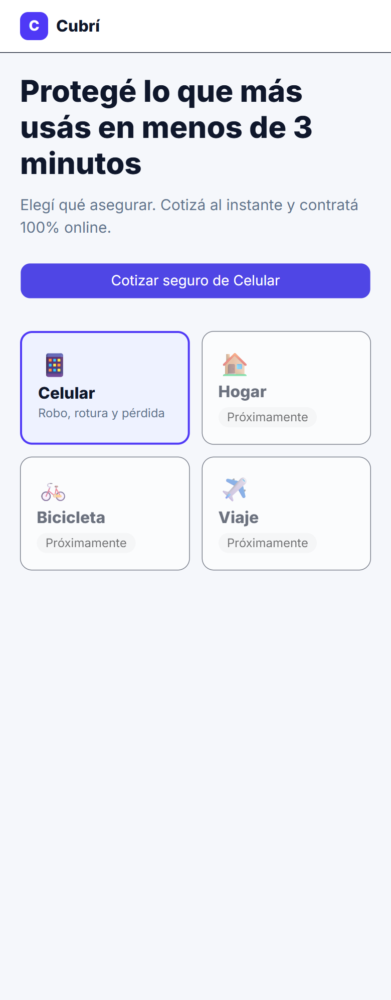 | 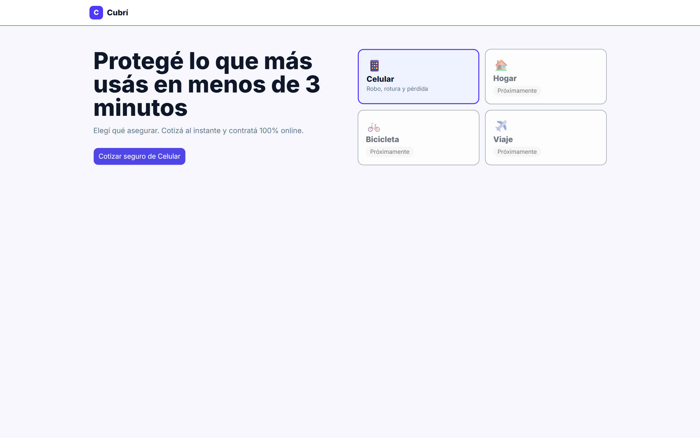 |
| Cotización | 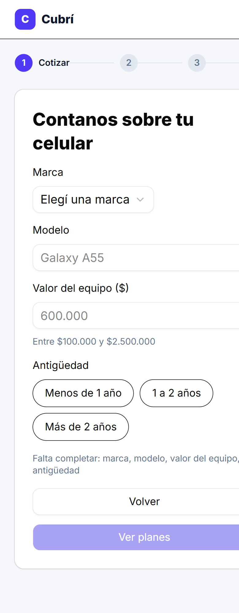 | 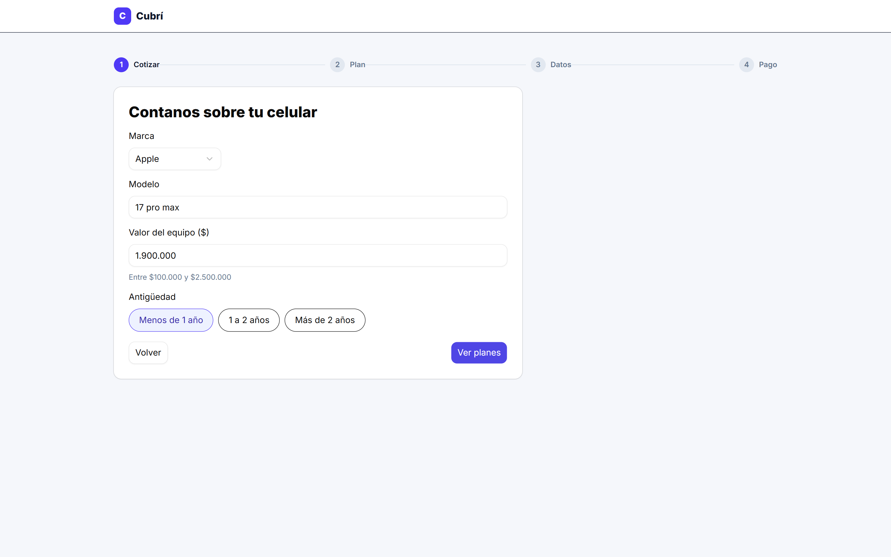 |
| Planes | 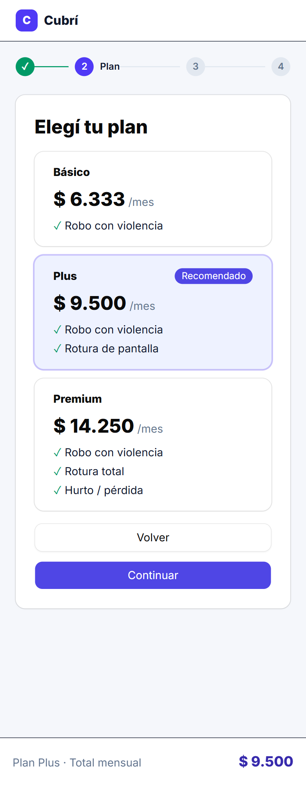 | 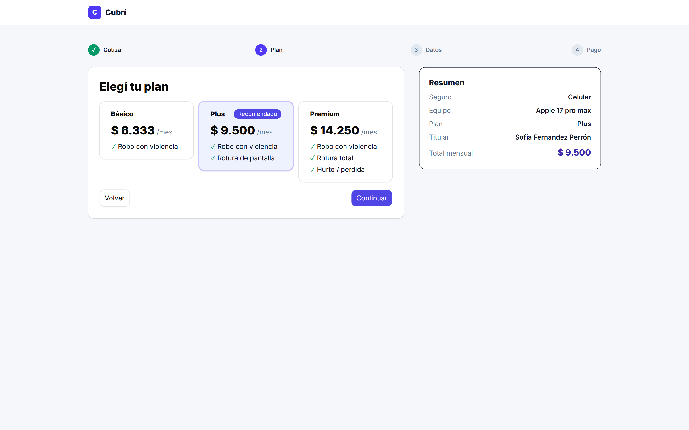 |
| Datos personales | 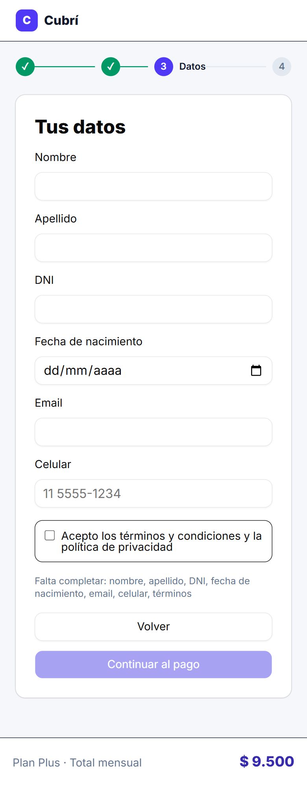 | 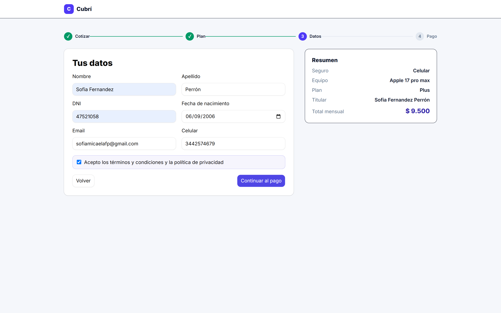 |
| Pago | 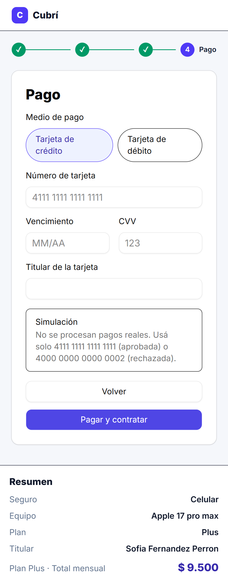 | 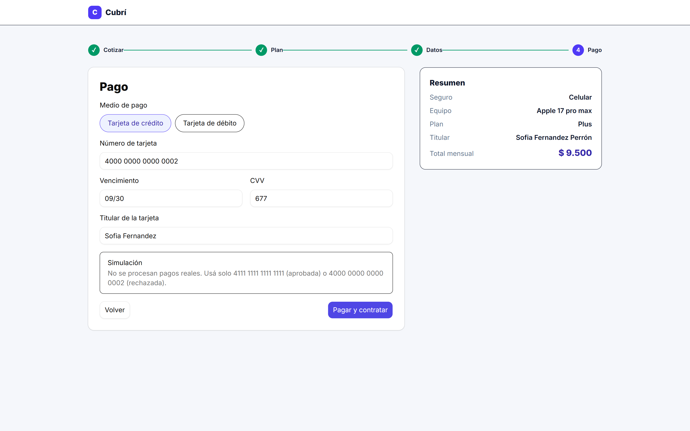 |
| Éxito | 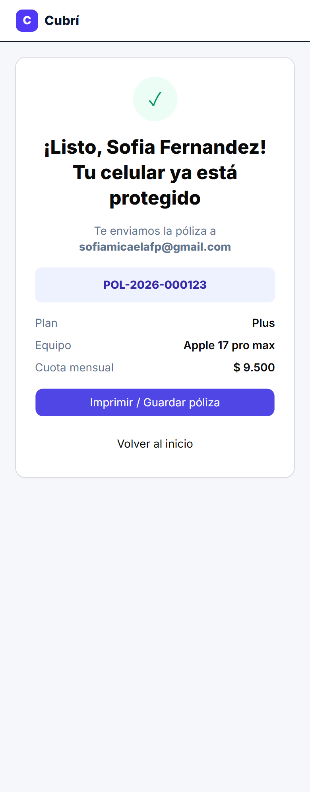 | 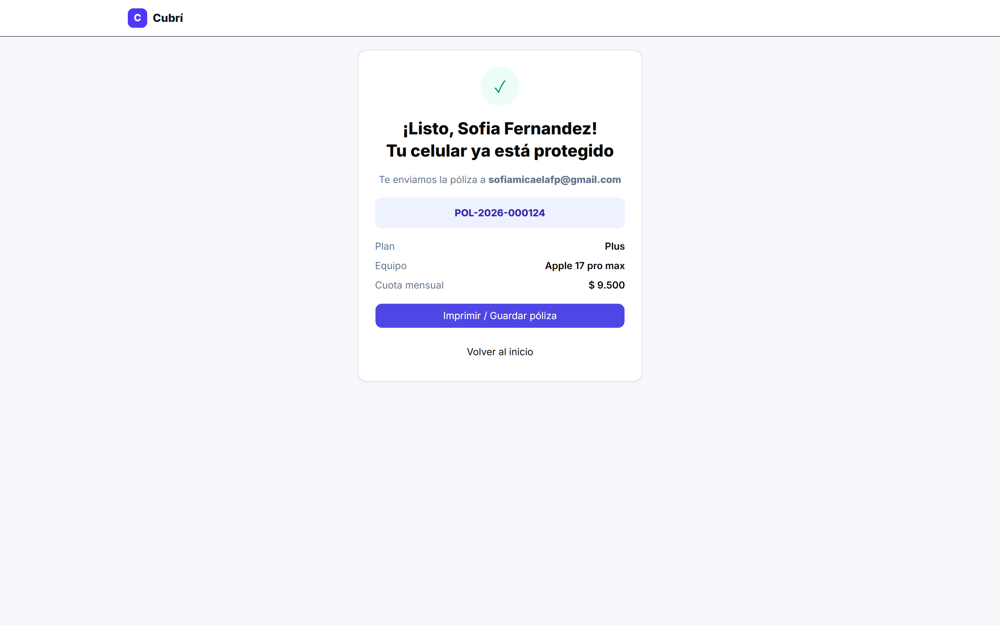 |
| Error de pago | 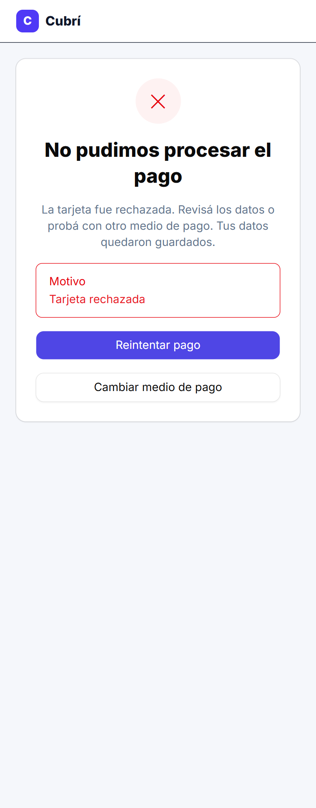 | 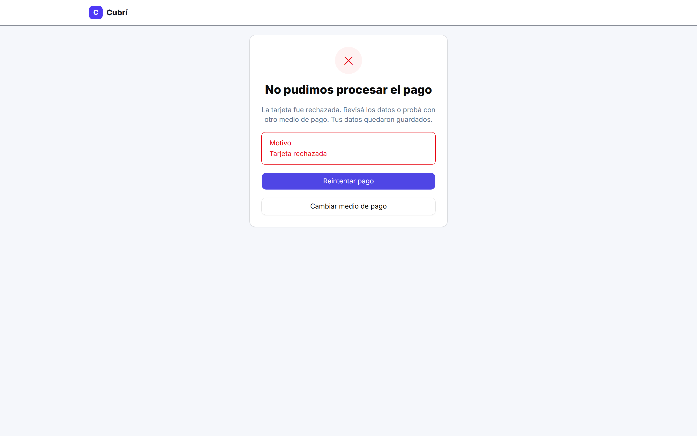 |

## Aclaraciones sobre la simulación
- El botón **Imprimir / Guardar póliza** usa la opción de impresión del navegador (`window.print()`); desde allí se puede elegir **Guardar como PDF**.
- El mensaje de envío de póliza es parte de la simulación: **no se envía ningún email real**.
- No ingresar datos de tarjetas reales. Usar únicamente los números de prueba de la consigna.

